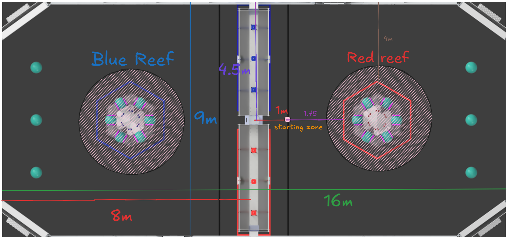

# Java Programming Tryouts

## TODO: Clarify wheel/drive speeds, create an empty template, create a diagram of everything, test this all in github codespaces, test this all on harry chen.

## Overview
You are a programmer on your school's FIRST robotics team, for the CRESCENDO season. The robot has been built and it is your job to
program an autonomous routine for it. However, before you can program the autonomous routine, you must program the individual "subsystems" (individual mechanisms) on the robot before having them work together in a full routine. The robot consists of three subsystems, the **Drive** subsystem, the **Shooter** subsystem, and the **Intake** subsystem. The **Drive** subsystem consists of two drive wheels, one on the left side of the robot and one on the right side, each powered by a single motor. The **Shooter** subsystem is a fixed-angle shooter on the front of the robot, consisting of multiple flywheels all powered by a single motor. The **Intake** subsystem is on the back of the robot, it is also fixed on the robot, and it also consists of several wheels that feed the game piece into the shooter, all powered by a single motor. Your goal is to program the autonomous routine described below for the robot.

## Autonomous Routine
The robot is placed directly in front of the goal, pre-loaded with the game piece. The front (where the shooter is) is facing the goal. The autonoumous routine is as follows:
- The robot shoots the piece into the goal for 3 seconds.
- The robot drives backwards 5 meters to a game piece.
- The robot intakes the game piece for 2 seconds.
- The robot drives forwards 5 meters back to the goal, and shoots the game piece for 3 seconds.
- The robot drives backwards 5 meters, turns clockwise 90 degrees, and then drives 2 meters backwards to another game piece.
- The robot intakes the game piece for 2 seconds, and now it's ready for the teleoperated period.
- The autonomous routine is now complete.
- (note: all drivetrain movements are at max speed, driving is at max speed, and so is rotation)

## What You Are Given
- A **Motor** class, which has a function to set its power. The power is a number ranging from [-1, 1], where -1 is full power in the reverse direction, 0 is no power, and 1 is full power in the forward direction. Full power means that the motor is spinning at its maximum speed. ***scroll below to see function documentation on the Motor class***
- A **Util** class containing many utility functions. The most important ones **toDriveSpeeds()** and **toWheelSpeeds()**, which you'll have to use to control the drivetrain. ***scroll below to see function documentation on the Util class***
- Existing **Drive**, **Shooter**, and **Intake** classes that you will fill with code. ***see programming section below for more info***

## Class Documentation
## Motor Class *(these are the most important functions, however there are more in lib/Motor.java)*

## `public void setPower(double power)`

Sets the power of the motor [-1, +1].

 

## Util Class *(these are the most important functions, however there are more in lib/Util.java)*

## `public static void sleep(double seconds)`

Pause execution for some amount of time.

 * **Parameters:** `seconds` — The seconds to sleep for.

## `public static WheelSpeeds toWheelSpeeds( DriveSpeeds driveSpeeds, double trackWidth )`

Performs inverse kinematics for a tank drive, converting drive speeds to wheel speeds. This'll take speeds meant for the 
whole drive train and convert them into the speeds for each individual wheel.

 * **Parameters:**
   * `driveSpeeds` — The desired drive speeds.
   * `trackWidth` — The track width between the left and right wheels.

     

 * **Returns:** A new {@link WheelSpeeds} object.

## `public static DriveSpeeds toDriveSpeeds( WheelSpeeds wheelSpeeds, double trackWidth )`

Performs forward kinematics for a tank drive, converting wheel speeds to drive speeds. This'll take the speeds of
each individual wheel and convert it into speeds of the whole drive train.

 * **Parameters:**
   * `wheelSpeeds` — The current wheel speeds on the drivetrain.
   * `trackWidth` — The track width between the left and right wheels.

     

 * **Returns:** A new {@link DriveSpeeds} object.

 

## DriveSpeeds Class

Purpose: Represents the speeds for a tank drivetrain.

## `public final double translationMetersPerSecond`

Translational speed in meters per second.

## `public final double omegaDegreesPerSecond`

Rotational speed in degrees per second (positive is clockwise, negative is counter-clockwise).

## WheelSpeeds Class

Purpose: Represents the individual wheel speeds for a tank drivetrain.

## `public final double leftMetersPerSecond`

The speed of the left wheel in meters per second.

## `public final double rightMetersPerSecond`

The speed of the right wheel in meters per second.

## Programming
- The **Drive** subsystem is its own class, with template methods you must code in.
- The **Shooter** subsystem is its own class, with template methods you must code in.
- The **Intake** subsystem is its own class, with template methods you must code in.
- Each subsystem class is be defined in the **subsystems** folder.
- Each subsystem should be instantiated in the **Robot** class, and the autonomous routine must be programmed in the **autonomous()**
function of the robot class.

## **Good Luck! (NOTE: you may look up anything you need, just don't copy code directly without understanding)**
