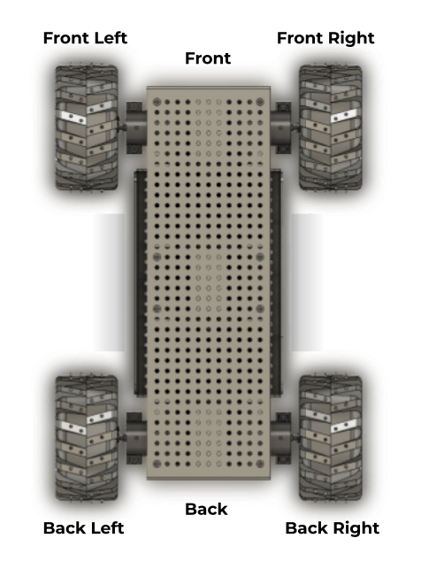
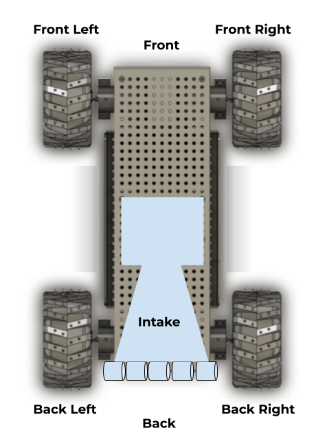
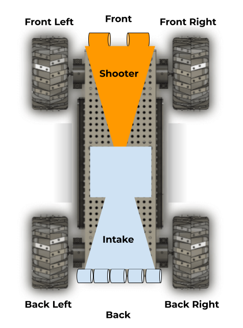
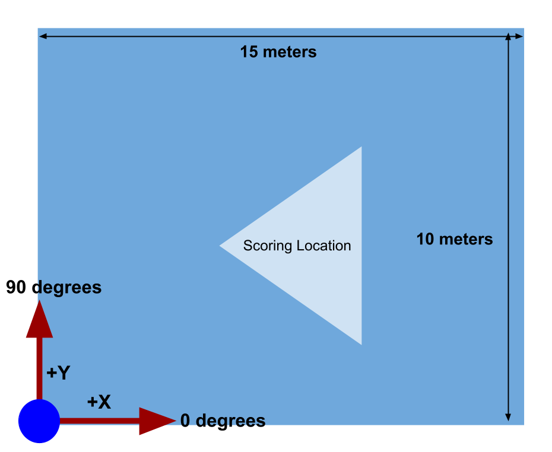

# The Robot
The mechanical team just finished building the robot, and you are assigned to program an **autonomous routine** for the robot. The robot has a **Drive** subsystem, an **Intake** subsystem, and a **Shooter** subsystem that you must code along with the autonomous routine. 

## Drive
The Drive subsystem consists of four wheels, with each one located on a corner of the chassis and controlled by **1 motor each**. These motors are labeled “front left”, “front right”, “back left”, and “back right”, which corresponds to their location on the chassis.

## Intake
The Intake subsystem is **located on the back of the robot**, and consists of a set of feeder wheels, all controlled by **1 motor**. When intaking, the motor should spin at full speed for 2 seconds, then stop. 

## Shooter
The Shooter subsystem is **located on the front of the robot**, and consists of a set of feeder wheels, all controlled by **1 motor**. When shooting, the motor should spin at full speed for 4 seconds, then stop.

# Autonomous Routine
  

You will be given 30 min to code and debug. **You must code in the functions where there is a //TODO indication**. Your objective is to code an autonomous routine that’ll pick up and score as many game pieces as possible by executing periodic “cycles” in the routine. 

Each “cycle” constitutes driving to the game piece position, intaking it, driving to the scoring position, and finally shooting the game piece. When driving to a position, the chassis should first rotate to face that position, then drive to the position, and then finally rotate to that position’s heading.

To code the autonomous routine, you first need to code the *Drive.java*, *Intake.java*, and *Shooter.java* subsystem files. You are also given the library files *Util.java* and *Motor.java*.

# Class Documentation

## `public class Motor`

Represents a motor on the robot.

## `public Motor()`

Creates a new Motor.

## `public void setPower(double power)`

Sets the power of the motor.

 * **Parameters:** `power` — The motor power in range [-1, 1] where:

     -1 = full reverse

     0 = stopped

     1 = full forward

## `public double getSpeed()`

Gets the current speed of the motor.

 * **Returns:** The motor speed in rotations per second (RPS).

## `public class FieldPosition`

Represents a position on the field with x, y coordinates and heading.

## `public FieldPosition(double xMeters, double yMeters, double headingDegrees)`

Creates a new FieldPosition.

 * **Parameters:**
   * `xMeters` — X coordinate in meters.
   * `yMeters` — Y coordinate in meters.
   * `headingDegrees` — Heading in degrees.

## `public FieldPosition()`

Creates a new FieldPosition at the origin with 0 degrees heading.

## `public double getX()`

Gets the X coordinate.

## `public double getY()`

Gets the Y coordinate.

## `public double getHeading()`

Gets the heading.

## `public double distanceTo(FieldPosition other)`

Calculates the distance between this FieldPosition and another FieldPosition.

 * **Parameters:** `other` — The other FieldPosition.

     

 * **Returns:** The distance in meters.

## `public double angleTo(FieldPosition other)`

Calculates the angle from this FieldPosition to another FieldPosition.

 * **Parameters:** `other` — The other FieldPosition.

     

 * **Returns:** The angle in degrees.

## `public class Util`

Utility class containing helper functions.

## `public static void sleep(double seconds)`

Pauses execution for a specified duration.

 * **Parameters:** `seconds` — The duration to sleep in seconds (will be clamped 1-135s)

## `public class Constants`

Contains all robot constants.

## `public static final double maxRobotSpeedMetersPerSecond = Motor.maxSpeedRPS * wheelCircumference`

Max robot linear speed in m/s.

## `public static final double maxRobotAngularSpeedDegreesPerSecond = Math.toDegrees(2 * maxRobotSpeedMetersPerSecond`

Max robot angular speed in deg/s.

## `public static final FieldPosition scoringPosition = new FieldPosition(10, 10, 10)`

The scoring position.