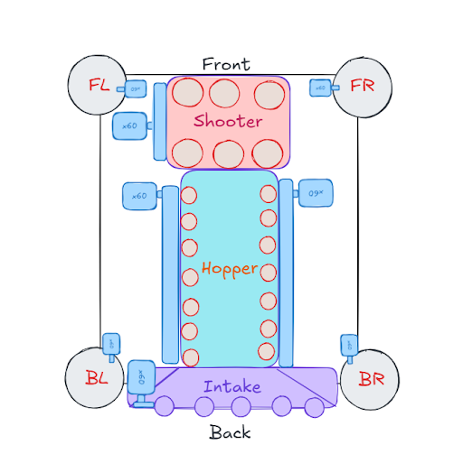

## The Robot

The CAD team just finished building the robot, and you are assigned to program a simulation for the robot. The robot has a **Drive** subsystem, an **Intake** subsystem, a **Hopper** subsystem, and a **Shooter** subsystem that you must code for all of them to work simultaneously. The motors are identical and labeled x60. The small circles inside the mechanism are the **feeder wheels**.

### Tank Drive

The Drive subsystem consists of four wheels, with each one located on a corner of the chassis and controlled by **1 motor each**. These motors are labeled “front left”, “front right”, “back left”, and “back right”, which corresponds to their location on the chassis.

### Intake

The Intake subsystem is **located on the back of the robot**, and consists of a set of feeder wheels, all controlled by **1 motor**. When intaking, the motor should spin at full speed for 2 seconds, then stop.

### Hopper

The Intake subsystem is **located in the middle of the robot**, and consists of a set of feeder wheels on both sides, all controlled by **2 motors**. When indexing, the motors should spin at full speed for 2 seconds, then stop.

### Shooter

The Shooter subsystem is **located on the front of the robot**, and consists of a set of feeder wheels, all controlled by **1 motor**. When shooting, the motor should spin at full speed for 4 seconds, then stop.

### [Optional] LED

> The LED is optional task.

The LED subsystem gets the current color of what command is currently running and sets the LED to custom color besides the idle/current color.

## Your Task

Currently, the current codebase isn’t complete, so it is your responsibility to fill in the code given the information above. You are not allowed to use the internet or your phone. 

You have **45 minutes** to complete this task. Good Luck!
